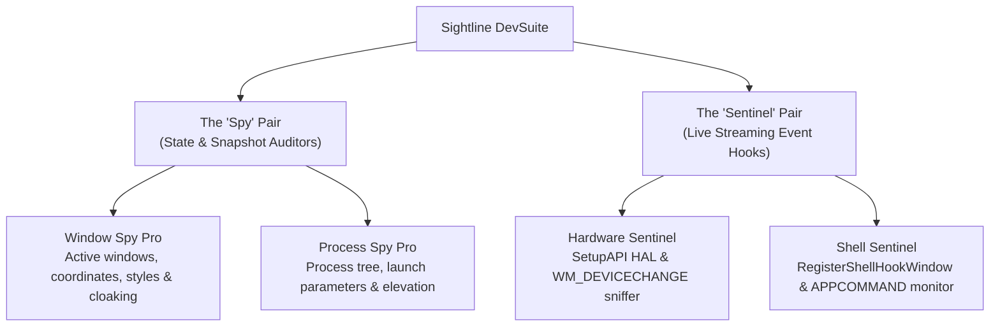

# Sightline DevSuite

**Sightline DevSuite** is a specialized collection of lightweight, high-performance Windows development, debugging, and system auditing utilities written in AutoHotkey.

The suite is architected around a symmetrical 2×2 taxonomy: two **Spy** utilities for inspecting static system state, and two **Sentinel** utilities for real-time OS hook monitoring.

For complete deep-dive architectural specifications, Win32 memory layouts, and API details, see **[DESIGN.md](DESIGN.md)**.

---

## The Suite Architecture



---

## Utilities Overview

| Utility | Type | Tray & Minimization | Logging Model | Documentation |
| :--- | :--- | :--- | :--- | :--- |
| **Window Spy Pro** | Spy (State) | Taskbar only (No Tray Icon) | On-demand snapshot (`Log to File` button) | [Guide](docs/Window_Spy_Pro.md) |
| **Process Spy Pro** | Spy (State) | Taskbar only (No Tray Icon) | On-demand snapshot (`Log to File` button) | [Guide](docs/Process_Spy_Pro.md) |
| **Hardware Sentinel** | Sentinel (Hook) | System Tray (Minimizes to Tray) | Live event stream (`Log to file` checkbox) | [Guide](docs/Hardware_Sentinel.md) |
| **Shell Sentinel** | Sentinel (Hook) | System Tray (Minimizes to Tray) | Live event stream (`Log to file` checkbox) | [Guide](docs/Shell_Sentinel.md) |

### Design Paradigm: Spies vs. Sentinels

* **The Spies (`Window Spy Pro`, `Process Spy Pro`):**
  * **Role:** State & snapshot auditors. They inspect what currently exists on the machine.
  * **Tray Behavior:** **No system tray icons**. They operate as clean desktop utilities that live in the taskbar when open and terminate completely when dismissed.
  * **Logging:** Because they inspect static states rather than streams of events, they feature an on-demand **`Log to File`** button that exports an instant formatted snapshot of the active query or filter.
* **The Sentinels (`Hardware Sentinel`, `Shell Sentinel`):**
  * **Role:** Live OS message hooks. They watch for real-time system mutations (plug/unplug events, window lifecycles, macro keys).
  * **Tray Behavior:** **System tray resident**. Clicking either the minimize button or close button tucks the sentinel into the system tray so monitoring continues uninterrupted. A single click on the tray icon restores the window.
  * **Logging:** They feature a persistent **`Log to file (...)`** live checkbox toggle that streams each intercepted event directly to disk in real time.

---

## Dual-Mode Architecture: Human GUI + AI Agent Headless CLI

All flagship AHKv2 utilities (`src/` and `bin/v2/`) support **Dual-Mode Execution**:
* **Launched normally (double-click):** Runs as an interactive desktop GUI with clean typography, responsive layouts, and dedicated vector taskbar icons (instantly freeing the initial console).
* **Invoked with CLI arguments:** Runs **headlessly** without creating a GUI, reserving the terminal prompt to emit synchronous structured text or **JSON / NDJSON** streams to `stdout` with clean exit codes (`0` = success/matched, `1` = usage error, `2` = no matches).

### Agent & CLI Cheat Sheet

```powershell
# Window Spy Pro: Dump visible windows matching "Chrome" in structured JSON
Window_Spy_Pro.exe -j -s visible -f "Chrome"

# Process Spy Pro: Inspect launch command line and memory metrics of a specific PID
Process_Spy_Pro.exe -j -m -p 12260

# Shell Sentinel: Listen for 10 seconds for window creation & destruction in NDJSON
Shell_Sentinel.exe -j -t 10 -e create,destroy

# Hardware Sentinel: Dump current motherboard peripheral inventory to JSON
Hardware_Sentinel.exe --snapshot --json --filter "USB"

# Hardware Sentinel: Listen for 15 seconds to catch live peripheral plug/unplug events
Hardware_Sentinel.exe --listen --timeout 15 --json
```

### Structured Output Formats

#### 1. Formatted Snapshot Output (Spies & Hardware Snapshot)
```json
[
  {
    "commandLine": "\"C:\\WINDOWS\\system32\\cmd.exe\"",
    "elevated": false,
    "name": "cmd.exe",
    "path": "C:\\WINDOWS\\system32\\cmd.exe",
    "pid": 14208
  }
]
```

#### 2. Streaming Line-Delimited JSON / NDJSON (Sentinels in Live Mode)
```json
{"eventCode":1,"eventName":"HSHELL_WINDOWCREATED","hwnd":"0x00020B44","pid":1234,"process":"notepad.exe","timestamp":"2026-10-19T01:30:00","title":"Untitled - Notepad"}
{"eventCode":4,"eventName":"HSHELL_WINDOWACTIVATED","hwnd":"0x00020B44","pid":1234,"process":"notepad.exe","timestamp":"2026-10-19T01:30:01","title":"Untitled - Notepad"}
```

---

## Engineering & Performance Optimizations

* **Flicker-Free $O(1)$ Win32 Terminal Streaming:** Sentinels append real-time text using direct Win32 messages (`EM_SETSEL` + `EM_REPLACESEL` + `WM_VSCROLL`), bypassing heavy text buffer re-reads and eliminating GUI flicker.
* **Pre-Allocated Memory Buffers:** Reusable memory buffers (`RECT`, SetupAPI instance IDs, device property buffers) prevent heap fragmentation during rapid scans.
* **Early Rejection Pipeline:** Window and process filters discard non-matching candidates before invoking expensive Win32 API calls (`DwmGetWindowAttribute`, token elevation checks).
* **Hardware Insertion Storm Debouncing:** Rapid hardware notification bursts (e.g. multi-interface USB devices) are collapsed via 300ms debounce timers into a single inventory scan.
* **Conditional Token Auditing:** Process Spy Pro skips expensive security token inspection during interactive GUI rendering, reserving it strictly for CLI queries that request elevation data.

---

## Operating System Compatibility & Editions

Sightline DevSuite offers two distinct implementations to suit modern workflows and vintage/industrial environments:

* **Primary Edition (`src/`):** Built for **AutoHotkey v2.0+** (64-bit). Uses typed memory buffers, native associative maps, exception handling, and modern object-oriented GUI events.  
  * **Supported OS:** Windows 7, Windows 8/8.1, Windows 10, Windows 11.
* **Legacy Edition (`legacy/`):** Built for **AutoHotkey v1.1.x**. Preserved as a frozen compatibility release for legacy systems, virtual machines, and vintage testbenches.  
  * **Supported OS:** Windows XP (SP3), Windows Vista, Windows 7, Windows 8/8.1, Windows 10, Windows 11.

---

## Repository Structure

```text
Code_Tool_Sightline_DevSuite/
├── assets/
│   ├── Process_Spy_Pro.ico     # Dedicated Process Spy Pro icon
│   ├── Window_Spy_Pro.ico      # Dedicated Window Spy Pro icon
│   ├── Hardware_Sentinel.ico   # Dedicated Hardware Sentinel icon
│   ├── Shell_Sentinel.ico      # Dedicated Shell Sentinel icon
│   ├── suite_icons_preview.png # Visual icon suite preview
│   └── icon.ico                # Fallback master icon
├── bin/                        # Compiled standalone executables (generated by build)
│   ├── v1/                     # Legacy AHKv1 binaries (WinXP - Win11)
│   └── v2/                     # Modern flagship AHKv2 binaries (Win7 - Win11)
├── docs/                       # Individual utility documentation guides
│   ├── Hardware_Sentinel.md
│   ├── Process_Spy_Pro.md
│   ├── Shell_Sentinel.md
│   └── Window_Spy_Pro.md
├── legacy/                  # Frozen AHKv1 scripts (WinXP / Vista compatible)
│   ├── Hardware_Sentinel.ahk
│   ├── Process_Spy_Pro.ahk
│   ├── Shell_Sentinel.ahk
│   └── Window_Spy_Pro.ahk
├── scripts/
│   ├── generate_icons.ps1      # Pure PowerShell vector icon rendering pipeline
│   └── make.bat                # Interactive multi-target build script
├── src/                        # Active AHKv2 codebase (Windows 7 - 11)
│   ├── Hardware_Sentinel.ahk
│   ├── Process_Spy_Pro.ahk
│   ├── Shell_Sentinel.ahk
│   └── Window_Spy_Pro.ahk
├── DESIGN.md                   # Comprehensive technical & architectural design specification
├── LICENSE                     # GNU General Public License v3.0
└── README.md                   # Suite overview and documentation index
```

---

## Building Standalone Executables

To compile the scripts into standalone `.exe` binaries without needing AutoHotkey installed on target machines:

1. Ensure [AutoHotkey](https://www.autohotkey.com/) and the **Ahk2Exe** compiler are installed.
2. Run `scripts/make.bat`.
3. Choose your build target from the menu:
   * **[1] Build All AHKv2 Utilities** &rarr; Outputs to `bin/v2/`
   * **[2] Build All AHKv1 Legacy Utilities** &rarr; Outputs to `bin/v1/`
   * **[3] Build Everything** &rarr; Compiles both v1 and v2 editions

Or build non-interactively from terminal:
```cmd
scripts\make.bat all
```

---

## License

This suite is licensed under the terms of the **GNU General Public License v3.0**. See the [LICENSE](LICENSE) file for complete details.