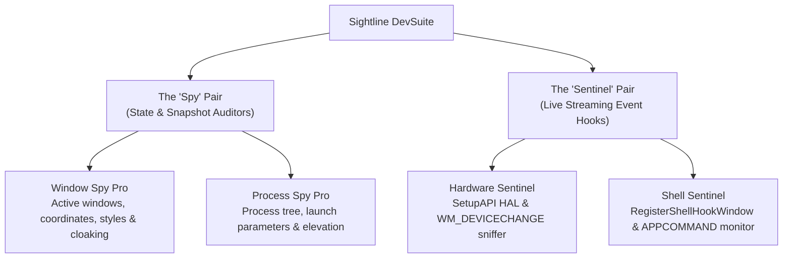

# Sightline DevSuite Wiki

Welcome to the **Sightline DevSuite** documentation wiki!

Sightline DevSuite is a specialized collection of lightweight, high-performance Windows development, debugging, and system auditing utilities written in AutoHotkey v2 (with legacy v1 implementations preserved).

---

## 🏛️ Symmetrical 2×2 Architecture

The suite is structured around a symmetrical 2×2 matrix:

---

## 🛠️ Tool Documentation Pages

| Utility | Type | Role | CLI Streaming / Output | Documentation |
| :--- | :--- | :--- | :--- | :--- |
| **[Window Spy Pro](Window_Spy_Pro)** | Spy | Point-in-time active window auditor, DWM cloaking filter & spatial coordinate inspector | Formatted Text / JSON Array | [[Window_Spy_Pro]] |
| **[Process Spy Pro](Process_Spy_Pro)** | Spy | WMI process auditor, launch command line & privilege detector | Formatted Text / JSON Array | [[Process_Spy_Pro]] |
| **[Hardware Sentinel](Hardware_Sentinel)** | Sentinel | Real-time HAL peripheral observer & SetupAPI enumerator | Text Stream / Line-Delimited JSON (NDJSON) | [[Hardware_Sentinel]] |
| **[Shell Sentinel](Shell_Sentinel)** | Sentinel | Low-level OS shell hook observer & multimedia APPCOMMAND sniffer | Text Stream / Line-Delimited JSON (NDJSON) | [[Shell_Sentinel]] |

---

## ⚡ Dual-Mode Execution: Human GUI + AI Agent Headless CLI

All flagship AHKv2 utilities in the suite provide **Dual-Mode Execution**:
- **Desktop GUI Mode:** Launching normally opens a responsive Win32 desktop interface with custom vector typography and taskbar integration.
- **Headless CLI Mode:** Invoking with CLI arguments (`-j`, `-f`, `-s`, etc.) executes headlessly, attaching directly to the calling console to emit structured data with clean exit codes (`0` = success/match, `1` = usage error, `2` = no match).

---

## 📚 Deep Dive Specifications
For comprehensive Win32 system interaction models, low-level memory layouts, and API details, check the suite's design specifications.
